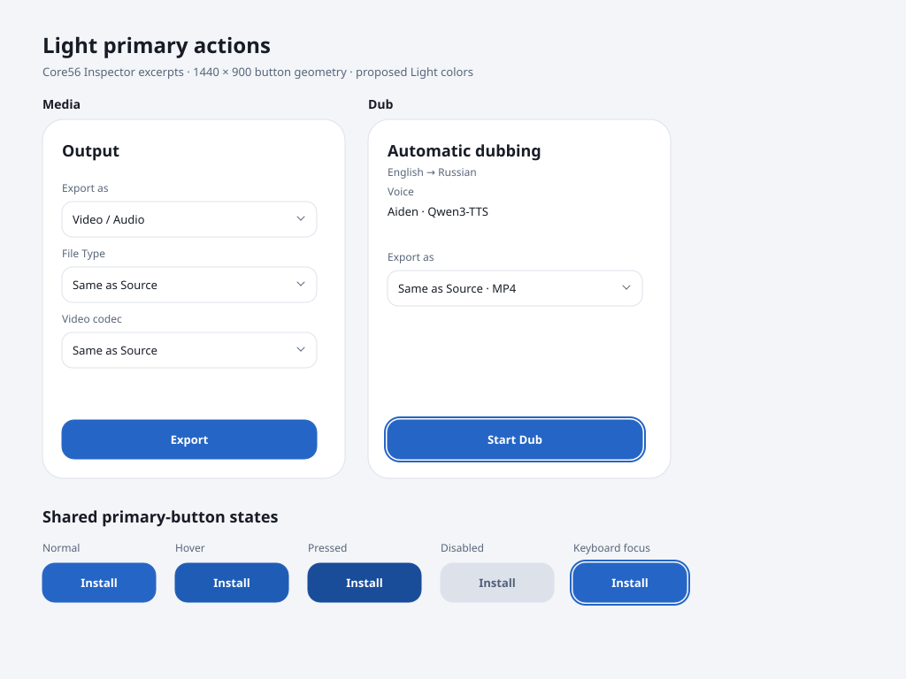

# MediaForge 1.0

MediaForge is a Windows x64 desktop application for local media editing, export and
English-to-Russian video dubbing. Media combines a source Viewer and timeline with
Trim, Crop, Reformat and Export. Dub uses the original source and can run with the
installed local Qwen3-TTS Aiden voice. Settings manages appearance, portable storage
and optional Dub components.

## Run the Windows portable build

Extract the entire `MediaForge-1.0.0-win64.zip` to a writable local folder and
open `MediaForge.exe`. Choose **Yes** when setup offers to download the required
runtime. The first launch needs an internet connection and about 400 MiB of
downloads from PyPI, GitHub and Gyan. Setup verifies the pinned files before
opening MediaForge. Windows 10 or 11 x64 with its built-in .NET Framework
is required. A separate Python installation and administrator access are unnecessary.

Subsequent launches use the prepared runtime for offline editing and export.
Settings and temporary files live under `Data/v2` beside the executable.
Install optional Dub models and runtimes through Settings when you want to use
local dubbing. See [portable setup and manual updates](docs/PORTABLE_BOOTSTRAP.md).

See the [1.0.0 release notes](RELEASE_NOTES.md) for supported workflows and
important limits.

Start development with [Development and recovery](docs/DEVELOPMENT.md).
Repository agents start with [AGENTS.md](AGENTS.md).

## License

MediaForge's original code and project-owned design assets are licensed under
[GPL-3.0-only](LICENSE). See the [copyright and scope notice](COPYRIGHT.md)
and [third-party notices](docs/THIRD_PARTY_NOTICES.md) for separately
licensed material.
