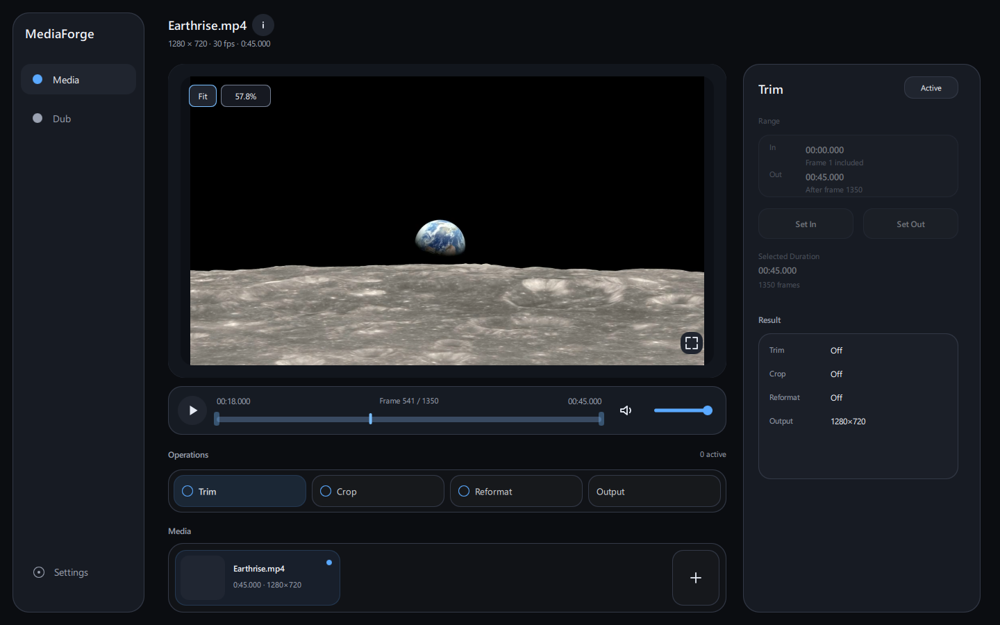
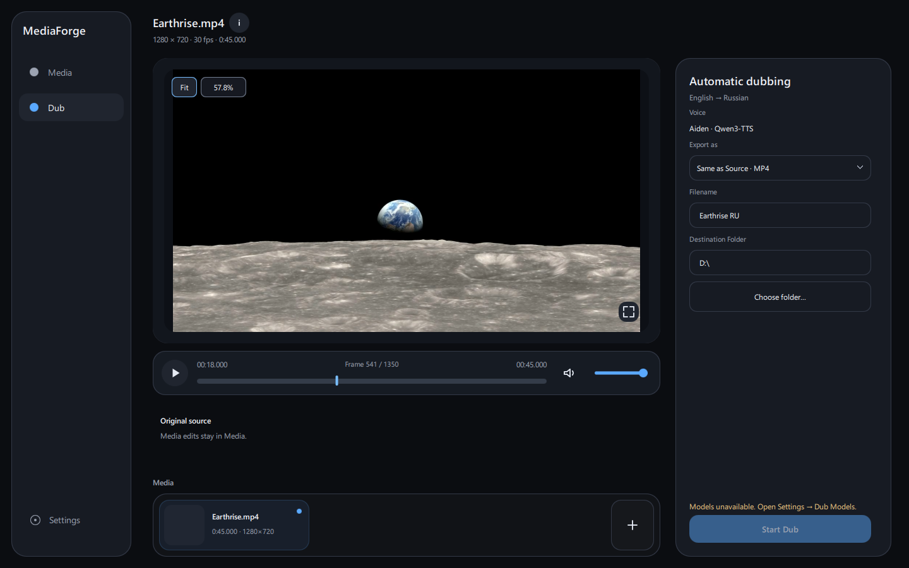
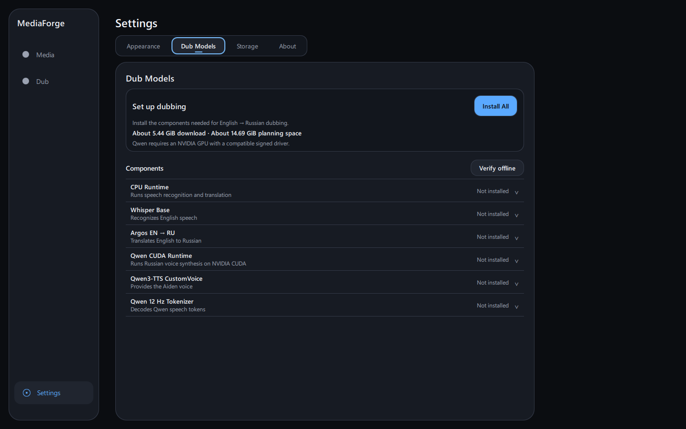

# MediaForge

**Portable media processing & automatic dubbing**

A free, open-source desktop application for media processing, conversion and English-to-Russian video dubbing.

### [Download Latest Release](https://github.com/avahgard/MediaForge/releases/latest)

## Features

- **Trim** — Cut unwanted parts of video.
- **Crop** — Adjust the visible image area.
- **Resize & Reformat** — Change resolution and framing.
- **Convert & Compress** — Export media with configurable output settings.
- **Image Sequences** — Import and process image sequences.
- **Automatic Dubbing** — Translate and dub English videos into Russian.
- **Portable** — No installer or system Python required.

## Screenshots

| Dub | Settings |
| :---: | :---: |
|  |  |
| English-to-Russian dubbing, voice and output controls | AI model and runtime management |

Demonstration footage uses NASA Scientific Visualization Studio imagery and Apollo 8 onboard audio. [Earthrise: The 45th Anniversary](https://svs.gsfc.nasa.gov/4129/)

## Getting Started

1. Download the latest Windows ZIP.
2. Extract it to a writable local folder.
3. Launch `MediaForge.exe`.
4. Allow the one-time runtime download.
5. Start using MediaForge.

The initial setup requires an internet connection and approximately 400 MiB of downloads. Subsequent media processing works offline.

Optional AI models can be downloaded through Settings. See the [release notes](RELEASE_NOTES.md) for supported workflows and limits.

## System Requirements

- Windows 10 / 11 (64-bit) with the built-in .NET Framework.
- Internet connection for initial setup.
- No administrator access required.

## Updating

Follow the [manual update instructions](docs/PORTABLE_BOOTSTRAP.md#manual-update) to preserve your settings and downloaded AI models.

## Development

See the [development documentation](docs/DEVELOPMENT.md) for architecture, build instructions and contribution guidelines.

## License

MediaForge is free and open-source software licensed under [GPL-3.0-only](LICENSE). Third-party components retain their respective licenses.

Copyright © 2026 the MediaForge contributors. See the [copyright and scope notice](COPYRIGHT.md) and [third-party notices](docs/THIRD_PARTY_NOTICES.md).
